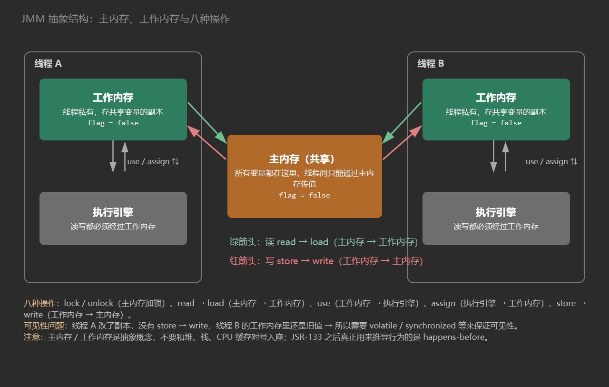

# Java 内存模型（JMM）

面试官问：『说说什么是 Java 内存模型（JMM）？』

很多人张口就是：『Java 内存主要分为五大块：堆、方法区、虚拟机栈、本地方法栈、程序计数器……』

这是 JVM 运行时数据区，不是 JMM。两个名字只差一个词，考的是完全不同的东西。

| 对比项 | JVM 运行时数据区 | Java 内存模型（JMM） |
| --- | --- | --- |
| 是什么 | 内存的逻辑划分 | 并发编程的规范 / 规则 |
| 内容 | 堆、方法区、虚拟机栈、本地方法栈、程序计数器 | 主内存、工作内存、8 种操作、happens-before |
| 关注点 | 内存放在哪、怎么分配、怎么回收 | 多线程读写共享变量时，可见性、原子性、有序性怎么保证 |
| 规范来源 | JVM 规范 | JSR-133、JLS 第 17 章 |
| 一句话类比 | 房子怎么隔房间 | 多个住户同时用一个房间的规矩 |

**运行时数据区解决"内存长什么样"，JMM 解决"多线程怎么正确地用内存"。**

## 一、为什么需要内存模型

JMM 不是拍脑袋定的，它是硬件必然带来的问题的软件解法。所以要先把硬件这层讲清楚。

### 1.1 CPU、缓存、主存

- **CPU**：一台服务器通常有多个 CPU，每个 CPU 又有多个核，核之间是真正并行的。一个 Java 多线程任务，很可能每个核上跑一个线程。
- **寄存器**：在 CPU 内部，速度最快，容量最小。
- **高速缓存**：L1 / L2 / L3，作为 CPU 和主存之间的缓冲。
- **主存**：内存条，容量最大，但比缓存慢几个数量级。

CPU 的运算速度远高于主存读写速度，所以必须引入缓存做缓冲：CPU 把要用的数据读进缓存，算完再写回主存。

### 1.2 缓存一致性问题

多核系统中，每个核有自己的缓存，却共享同一份主存。同一块主存数据被不同核缓存后，一个核改了、另一个核还拿着旧副本，就会读到过期数据。

解决方式是让 CPU 访问缓存时遵守一套协议，典型的是 **MESI**：

| 状态 | 含义 |
| --- | --- |
| M（Modified） | 本核独占且已修改，与主存不一致 |
| E（Exclusive） | 本核独占，与主存一致 |
| S（Shared） | 多个核共享，与主存一致 |
| I（Invalid） | 本核副本失效，需要重新读取 |

MESI 这类协议把"缓存一致性"压到了硬件层。但对写 Java 的人来说，**缓存一致性不等于程序正确性**——因为编译器和处理器还没算进来。

### 1.3 重排序

为了让运算单元尽可能满负荷，处理器会把指令乱序执行；编译器（包括 JIT）也会在不改变单线程语义的前提下调整指令顺序。这些优化统称**重排序**，分三类：

| 类型 | 由谁做 | 说明 |
| --- | --- | --- |
| 编译器优化重排序 | 编译器 / JIT | 不改变单线程语义的前提下，重新安排语句执行顺序 |
| 指令级并行重排序 | 处理器 | 无数据依赖时，重叠执行多条指令，改变机器指令顺序 |
| 内存系统重排序 | 处理器 | 使用缓存和写缓冲区，使加载 / 存储看起来是乱序的 |

写缓冲区（Store Buffer）是内存系统重排序的关键：写操作先进入缓冲区，CPU 不必等它真正落盘就继续执行后续指令。对单线程没影响，因为同一线程读自己刚写的值会从缓冲区转发；但对其他线程，这个写可能还没"看见"。

### 1.4 硬件内存屏障

既然重排序是硬件行为，硬件也提供了约束它的手段：**内存屏障（Memory Barrier / Fence）**。

CPU 层面的屏障指令强制屏障前后的内存访问满足一定顺序。不同架构的屏障指令不同，x86 上常见的是 `mfence`、`lfence`、`sfence`；Java 通过 JSR-133 定义了一层与架构无关的屏障语义，由 JIT 在生成机器码时映射到具体指令。

## 二、并发编程的三大问题

硬件层的三个机制，到了软件层就是三个经典问题：

| 硬件原因 | 软件问题 | 表现 |
| --- | --- | --- |
| 缓存不一致 | **可见性** | 一个线程改了共享变量，另一个线程看不到 |
| 处理器优化 / 指令重排序 | **原子性**（被破坏） | 一条看似完整的操作，被拆成多步后被其他线程插入 |
| 指令重排序 | **有序性** | 代码顺序和实际执行顺序不一致 |

### 2.1 可见性

```java
public class VisibilityDemo {
    private static boolean stop = false;

    public static void main(String[] args) throws InterruptedException {
        new Thread(() -> {
            while (!stop) {
                // 空转
            }
            System.out.println("线程退出");
        }).start();

        Thread.sleep(1000);
        stop = true;
        System.out.println("已把 stop 改为 true");
    }
}
```

这段代码很可能永远不打印"线程退出"。工作线程把 `stop` 读进了自己的缓存 / 寄存器，主线程改了主存里的值，工作线程却一直在用旧副本。

改成 `private static volatile boolean stop = false;` 就能退出——volatile 保证了可见性。

### 2.2 原子性

```java
private int count = 0;

public void incr() {
    count++;   // 读 → 加一 → 写回，三步
}
```

`count++` 在字节码层面是 `getfield`、`iconst_1`、`iadd`、`putfield` 四条指令。两个线程同时执行，完全可能都读到 0，各自加一后都写回 1，结果少加了一次。

用 `synchronized`、`Lock` 或 `AtomicInteger` 才能保证这一段是原子的。

### 2.3 有序性

```java
int a = 0;
boolean flag = false;

// 线程 A
a = 1;          // 1
flag = true;    // 2

// 线程 B
if (flag) {     // 3
    int i = a * a;   // 4
}
```

1 和 2 之间没有数据依赖，处理器或编译器可以把 2 排到 1 前面。线程 B 就可能看到 `flag == true` 但 `a == 0`，算出 `i = 0`。

单线程下永远看不出问题——这正是一堆并发 bug 在本地复现不了的原因。

### 2.4 解决思路

最粗暴的办法是干掉缓存、禁止一切优化，但性能会退回几十年前。实际做法是：**定义一套内存模型规范，只对"需要同步的地方"做约束**。JMM 的两种手段就是：

1. 限制编译器和处理器的重排序；
2. 插入内存屏障。

## 三、JMM 的抽象结构

### 3.1 主内存与工作内存

JMM 规定了一套抽象结构，把所有线程共享的变量放在**主内存（Main Memory）**，每个线程有自己的**工作内存（Working Memory / 本地内存）**，里面存的是共享变量的副本。

- 所有变量都存储在主内存中；
- 每个线程有私有的工作内存，保存该线程读写的共享变量副本；
- 线程对变量的所有操作都必须在工作内存中进行，不能直接读写主内存；
- 线程之间不能直接访问对方的工作内存，只能通过主内存传递。

注意：这里的"主内存 / 工作内存"是**抽象概念**，不要和 JVM 的堆、栈，以及硬件的缓存、内存一一对号入座。栈和堆既可能落在缓存里，也可能落在主存里，两者没有直接对应关系。



### 3.2 八种操作

JMM 用八种操作描述主内存和工作内存之间的交互：

| 操作 | 作用对象 | 含义 |
| --- | --- | --- |
| `lock` | 主内存 | 把变量标记为一条线程独占 |
| `unlock` | 主内存 | 释放锁定状态，其他线程才能 lock |
| `read` | 主内存 | 把变量值从主内存传到工作内存，供 load 使用 |
| `load` | 工作内存 | 把 read 得到的值放入工作内存的变量副本 |
| `use` | 工作内存 | 把变量值传给执行引擎 |
| `assign` | 工作内存 | 把执行引擎的值赋给工作内存变量 |
| `store` | 工作内存 | 把工作内存的值传到主内存，供 write 使用 |
| `write` | 主内存 | 把 store 传过来的值写入主内存变量 |

这八种操作必须成对出现：`read` + `load`、`store` + `write`，不能只做一半。

配套还有几条规则（来自经典 JMM 描述）：

1. 不允许 `read` 和 `load`、`store` 和 `write` 之一单独出现；
2. 不允许线程丢弃最近的 `assign` 操作；
3. 不允许线程无原因地把数据从工作内存同步回主内存；
4. 新变量只能在主内存中"诞生"，工作内存中不允许直接使用未初始化（未 load 或 assign）的变量；
5. 一个变量同一时刻只允许一条线程 `lock`，但同一线程可以重复 `lock`，需要相同次数的 `unlock` 才能解锁；
6. 对变量执行 `lock` 会清空工作内存中该变量的值，使用前需要重新 `load` 或 `assign`；
7. 不允许 `unlock` 一个没有被 `lock` 的变量，也不允许 `unlock` 别的线程锁住的变量；
8. 执行 `unlock` 之前，必须先把变量同步回主内存（`store` + `write`）。

::: info
这套"八大操作 + 规则"是 JSR-133 之前旧 JMM 的描述方式。JSR-133（Java 5）重写了 JMM，现代规范用 **happens-before** 来定义可见性和有序性。八种操作更像一份"教学模型"，面试可以讲，但别把它当成 JMM 的全部——真正能用来推导程序行为的是 happens-before。

:::

## 四、as-if-serial 与数据依赖

### 4.1 as-if-serial

**as-if-serial 语义**：不管怎么重排序，单线程程序的执行结果不能被改变。编译器和处理器必须遵守它。

所以重排序不是随便排的，前提是不存在**数据依赖**。

### 4.2 三种数据依赖

| 依赖 | 说明 | 示例 |
| --- | --- | --- |
| 写后读（RAW） | 先写，后读同一个变量 | `a = 1; b = a;` |
| 写后写（WAW） | 先写，后写同一个变量 | `a = 1; a = 2;` |
| 读后写（WAR） | 先读，后写同一个变量 | `b = a; a = 1;` |

有数据依赖的两个操作不能被重排序。但要注意：**这只在单线程 / 单处理器语义下成立**。多线程之间没有数据依赖的定义，两个线程的读写是可以随便交错的，这正是并发 bug 的土壤。

as-if-serial 也保护不了多线程——它只管单线程。

## 五、happens-before

### 5.1 它是什么

happens-before 是 JMM 给程序员的**可见性承诺**，不是"时间上先发生"。

如果 A happens-before B（记作 `A hb B`），那么：

- A 的执行结果对 B 可见；
- A 的执行顺序在 B 之前（从程序可观察的角度）。

但反过来：`A hb B` **不要求** A 真的在 B 之前执行。只要结果一样，重排序仍然允许。

这就是 happens-before 和"物理时间顺序"最大的区别——它是一个偏序关系，不是时间线。

### 5.2 八条规则

JLS 17.4.5 定义了以下 happens-before 规则：

| 规则 | 内容 |
| --- | --- |
| 程序次序规则 | 同一个线程内，按程序顺序，前面的操作 hb 后面的操作 |
| 监视器锁规则 | 对一个锁的解锁 hb 随后对同一个锁的加锁 |
| volatile 变量规则 | 对一个 volatile 变量的写 hb 随后对这个变量的读 |
| 线程启动规则 | `Thread.start()` hb 该线程中的任意操作 |
| 线程终止规则 | 线程中的所有操作 hb 其他线程从 `join()` 返回 |
| 线程中断规则 | 对线程 `interrupt()` 的调用 hb 被中断线程检测到中断事件 |
| 对象终结规则 | 一个对象的初始化完成 hb 它的 `finalize()` 方法的开始 |
| 传递性 | `A hb B` 且 `B hb C`，则 `A hb C` |

### 5.3 用规则推导可见性

```java
int x = 0;
volatile boolean flag = false;

// 线程 1
x = 42;          // 1
flag = true;     // 2  volatile 写

// 线程 2
if (flag) {      // 3  volatile 读
    System.out.println(x);   // 4
}
```

推导：

- 1 hb 2（程序次序规则）
- 2 hb 3（volatile 规则：写 hb 后续读）
- 3 hb 4（程序次序规则）
- 由传递性：1 hb 4

所以 4 一定能打印 42。

如果 `flag` 不加 volatile，1 和 4 之间没有任何 hb 关系，JMM 允许打印 0。注意：这种情况下不是"肯定打印 0"，而是"打印 0 或 42 都合法"，具体取决于硬件和 JIT。

### 5.4 没有 hb 关系会怎样

两个操作之间如果没有 happens-before 关系，JMM 允许它们任意排序，结果不确定。并发 bug 里那些"偶现""压测才出""线上才出"的问题，绝大多数就是这里漏了。

## 六、内存屏障

### 6.1 四种屏障

JMM 把屏障分成四类，JSR-133 Cookbook 给出了标准定义：

| 屏障 | 序列示意 | 保证 |
| --- | --- | --- |
| LoadLoad | `Load1; LoadLoad; Load2` | Load1 的读先于 Load2 及后续读完成 |
| StoreStore | `Store1; StoreStore; Store2` | Store1 的写对其他处理器可见先于 Store2 的写 |
| LoadStore | `Load1; LoadStore; Store2` | Load1 的读完成后，Store2 及后续写才能刷出 |
| StoreLoad | `Store1; StoreLoad; Load2` | Store1 对所有处理器可见后，才执行 Load2 |

`StoreLoad` 是全能屏障，开销最大，因为它要等写缓冲区真正刷出去。其余三种在多数处理器上通过限制重排序即可实现。

### 6.2 volatile 的屏障插入策略

JSR-133 Cookbook 给出的保守策略：

| 位置 | 插入的屏障 |
| --- | --- |
| 每个 volatile 写之前 | StoreStore |
| 每个 volatile 写之后 | StoreLoad |
| 每个 volatile 读之后 | LoadLoad + LoadStore |

展开看就是"四合一"：volatile 写 = StoreStore + 写 + StoreLoad，volatile 读 = 读 + LoadLoad + LoadStore。

### 6.3 x86 上实际怎么实现

x86 采用 TSO（Total Store Order）内存模型：

- 不允许 Load-Load、Load-Store、Store-Store 重排序；
- 只允许 Store-Load 重排序（写缓冲区导致）。

所以在 x86 上 LoadLoad、LoadStore、StoreStore 三种屏障都是空操作，只有 **StoreLoad** 需要真实指令——HotSpot 常用的做法是在 volatile 写后加一条 `lock addl $0, 0(ESP)`，利用 lock 前缀的全局内存序效果，等价于全屏障。

这也是"volatile 写比读贵"的硬件原因：读只剩两条空操作，写要有一条带 lock 前缀的指令。

### 6.4 锁的屏障语义

`synchronized` 的 `monitorenter` / `monitorexit` 也对应屏障：

| 动作 | 语义 | 屏障 |
| --- | --- | --- |
| `monitorenter`（加锁） | acquire | LoadLoad + LoadStore |
| `monitorexit`（解锁） | release | StoreStore + StoreLoad |

所以 synchronized 除了互斥，还天然带有可见性保证：线程 A 在同步块里的写，线程 B 拿到同一把锁后一定看得到。

### 6.5 Java 层的屏障 API

JDK 9 之后可以通过 `VarHandle` 直接使用屏障：

```java
VarHandle.loadFence();      // LoadLoad
VarHandle.storeFence();     // StoreStore
VarHandle.acquireFence();   // LoadLoad + LoadStore
VarHandle.releaseFence();   // LoadStore + StoreStore
VarHandle.fullFence();      // 全屏障
```

::: tip
`sun.misc.Unsafe` 里也有对应的 `loadFence()`、`storeFence()`、`fullFence()`。它们主要给框架、并发容器这类底层代码使用，业务代码基本用不到——但面试问"Java 怎么手动加内存屏障"时能答出来就是加分项。

:::

## 七、volatile

### 7.1 两条语义

volatile 只做两件事：

1. **保证可见性**：写 volatile 变量会立刻刷到主内存并使其他线程的副本失效；读 volatile 变量会从主内存重新读。
2. **禁止重排序**：通过上面那组屏障，禁止 volatile 读写与前后指令重排序。

它**不保证原子性**。

### 7.2 为什么 volatile++ 不安全

```java
public class Counter {
    private volatile int count;

    public void incr() {
        count++;   // 不是原子操作
    }
}
```

`count++` 包含"读 → 加一 → 写回"，volatile 只能保证每次读到最新值，但两条线程可能同时读到 1，各自加一后都写回 2，最终结果 2 而不是 3。

要原子就用 `AtomicInteger`（CAS）或加锁。

### 7.3 volatile 的适用场景

| 场景 | 是否合适 |
| --- | --- |
| 一个线程写、多个线程读的状态标志位 | ✅ 典型用法 |
| 双重检查锁定的单例引用 | ✅ 必须加 |
| 多个线程同时 `i++` | ❌ 不保证原子性 |
| 需要"读-改-写"复合操作 | ❌ 用 CAS 或锁 |
| 多个变量要一起保持一致 | ❌ 用锁 |

### 7.4 双重检查锁定（DCL）

```java
public class Singleton {
    private static volatile Singleton instance;

    public static Singleton getInstance() {
        if (instance == null) {              // 第一次检查
            synchronized (Singleton.class) {
                if (instance == null) {      // 第二次检查
                    instance = new Singleton();
                }
            }
        }
        return instance;
    }
}
```

`instance = new Singleton()` 在字节码层面大致是三步：

1. 分配内存；
2. 调用构造方法初始化对象；
3. 把引用指向这块内存。

第 2 步和第 3 步之间没有数据依赖，可能被重排序。于是另一个线程可能在第一次检查时看到 `instance != null`，但拿到的是**还没初始化完**的对象。

加上 `volatile` 后，写操作前的 StoreStore 屏障禁止了"初始化"和"引用赋值"互换，这个漏洞才被堵上。

## 八、synchronized 的内存语义

### 8.1 字节码层面

同步代码块编译后是 `monitorenter` 和 `monitorexit`；同步方法则是方法访问标志里的 `ACC_SYNCHRONIZED`，JVM 隐式执行同样的加锁 / 解锁。

### 8.2 happens-before 保证

- 解锁 hb 后续对同一把锁的加锁；
- 因此，线程 A 在同步块内的所有写，线程 B 获得同一把锁后都可见。

这条规则比 volatile 更强：volatile 只作用于单个变量，synchronized 作用于整段临界区。

### 8.3 锁升级

HotSpot 对 synchronized 做了锁升级优化，对象头 Mark Word 会随竞争情况变化（64 位，简化）：

| 状态 | Mark Word 主要内容 | 标志位 |
| --- | --- | --- |
| 无锁 | 分代年龄、hashCode、偏向标记 0 | `01` |
| 偏向锁 | 持有线程 ID、Epoch | `01`（偏向标记 1） |
| 轻量级锁 | 指向栈上锁记录的指针 | `00` |
| 重量级锁 | 指向 ObjectMonitor 的指针 | `10` |
| GC 标记 | 空 | `11` |

升级路径：

1. **偏向锁**：只有一个线程反复进入同步块时，把线程 ID 记在 Mark Word 里，后续进入不用 CAS。有别的线程来竞争就撤销偏向。
2. **轻量级锁**：线程在自己的栈帧里建锁记录，用 CAS 把 Mark Word 指向它；失败则自旋重试。
3. **重量级锁**：自旋失败或竞争激烈，膨胀为 ObjectMonitor，未抢到的线程进入阻塞队列，由操作系统调度。

::: info
偏向锁在 JDK 15 被 JEP 374 默认禁用，JDK 18 起已移除。面试时如果讲"偏向锁"，最好补一句版本背景，否则容易被追问。

:::

### 8.4 和 volatile 的对比

| 维度 | volatile | synchronized |
| --- | --- | --- |
| 原子性 | 只保证单次读 / 写 | 保证整段临界区 |
| 可见性 | 保证 | 保证 |
| 有序性 | 禁止指令重排序 | 临界区串行执行 |
| 是否阻塞 | 不阻塞 | 可能阻塞 |
| 粒度 | 变量级 | 代码块 / 方法级 |
| 适用 | 状态标志、DCL | 复合操作、多变量一致性 |

## 九、CAS

### 9.1 原理

CAS（Compare And Swap）是 CPU 提供的原子指令，包含三个操作数：

- V：内存地址；
- A：期望值；
- B：新值。

逻辑是：如果 V 处的值等于 A，就把它改成 B；否则什么都不做，返回失败。整个过程由一条指令保证原子性，中间不会被其他线程插入。

Java 侧的经典实现：

```java
public final int getAndIncrement() {
    int current;
    do {
        current = getIntVolatile(this, valueOffset);        // 读最新值
    } while (!compareAndSwapInt(this, valueOffset, current, current + 1));  // CAS 失败就重试
    return current;
}
```

`AtomicInteger`、`AtomicLong`、`AtomicReference`，以及 `ConcurrentHashMap` 的部分操作、AQS 的 state 更新，底层都是这套"读 → CAS → 失败重试"的自旋模式。

JDK 9 之后推荐用 `VarHandle` 替代 `Unsafe`：

```java
boolean ok = HANDLE.compareAndSet(this, expected, update);
```

### 9.2 ABA 问题

值从 A 变成 B 又变回 A，CAS 只比较"当前值等不等于期望值"，于是认为没人改过。

在计数器场景里通常无害；在链表、栈这类依赖节点身份的结构里可能致命——栈顶引用看着没变，但中间节点已经被换过一轮，后续操作可能踩到已经出队的节点。

解决办法是加版本号：

```java
AtomicStampedReference<Integer> ref = new AtomicStampedReference<>(100, 0);
int stamp = ref.getStamp();
ref.compareAndSet(100, 200, stamp, stamp + 1);
```

每次修改版本号加一，ABA 就变成了 `A(0) → B(1) → A(2)`，版本对不上，CAS 失败。

### 9.3 CAS 的缺点

| 缺点 | 说明 | 应对 |
| --- | --- | --- |
| 自旋开销 | 竞争激烈时反复失败重试，白耗 CPU | 用 `LongAdder` 分散热点、或退化为锁 |
| 只能保证一个变量的原子性 | 多个变量要一起变就无能为力 | `AtomicReference` 打包成对象，或用锁 |
| ABA 问题 | 值变回来就检测不到 | `AtomicStampedReference` / `AtomicMarkableReference` |
| 需要硬件支持 | 依赖 CPU 的 CAS 指令 | 现代主流架构都支持 |

## 十、final 字段的内存语义

final 是最容易被忽略的一块，但 JLS 17.5 专门为它定义了内存语义：

1. **写 final 字段**：在构造方法内对 final 字段的写入，与随后把该对象的引用赋值给其他变量，这两个操作不能重排序。实现上是在构造方法返回前插入 StoreStore 屏障。
2. **读 final 字段**：初次读一个包含 final 字段的对象引用，与随后读该 final 字段，这两个操作不能重排序。实现上是在读 final 字段前插入 LoadLoad 屏障。

效果是：**只要对象引用正确发布，其他线程看到的就是构造完成后的 final 值**，不需要额外同步。

```java
public class FinalDemo {
    final int x;

    public FinalDemo() {
        x = 42;   // 构造方法内写 final
    }
}
```

边界要注意：

- 上面的保证只针对 final 字段本身。如果 final 字段是引用类型，构造方法里对**引用对象的字段**的写入不在此保证范围内。
- 如果构造方法里把 `this` 泄漏出去（注册监听器、启动线程、放进静态集合），别的线程可能在构造完成前就拿到对象，final 的保证也就靠不住了。这就是常说的 **this 逃逸**。

## 十一、面试连环问

**Q：JMM 到底保证了什么？**

JMM 保证正确同步的程序在任意处理器上执行结果一致。正确同步指的是程序里所有共享变量的读写都通过 happens-before 建立了可见性关系，且临界区被正确互斥。没同步的部分，JMM 不做任何承诺。

**Q：volatile 能保证原子性吗？**

不能。它只保证单次读 / 写是原子的（其实普通变量的单次读写本来也是原子的），`volatile int i; i++` 依然有并发问题。

**Q：i++ 怎么保证线程安全？**

三种方式：`synchronized`、`Lock`、`AtomicInteger.incrementAndGet()`（CAS 自旋）。高并发下 `LongAdder` 更好。

**Q：DCL 单例为什么必须加 volatile？**

因为 `new` 不是原子操作，对象初始化和引用赋值可能重排序，导致其他线程看到非 null 但未初始化完成的对象。volatile 禁止了这个重排序。

**Q：happens-before 和 as-if-serial 有什么区别？**

as-if-serial 是给单线程用的：怎么优化都行，单线程结果不能变。happens-before 是给多线程用的：定义了跨线程的可见性规则。as-if-serial 保护不了多线程。

**Q：happens-before 是不是说 A 一定在 B 之前执行？**

不是。它表示 A 的结果必须对 B 可见。如果重排序不违反这一点，JMM 允许实际执行顺序和代码顺序不同。

**Q：内存屏障在 x86 上是什么情况？**

x86 是 TSO 模型，只允许 Store-Load 重排序，所以只有 StoreLoad 屏障需要真实指令，其余三种是空操作。HotSpot 常用 `lock addl` 实现全屏障。

**Q：synchronized 和 volatile 怎么选？**

只需要保证一个状态的可见性、不涉及复合操作，用 volatile；涉及"读-改-写"、多个变量要保持一致、需要互斥，用 synchronized 或 Lock。

**Q：CAS 有什么问题？**

自旋开销大、只能保证单个变量、存在 ABA。ABA 用版本号解决，多变量用 `AtomicReference` 打包或加锁。

**Q：JMM 里的锁机制只有 synchronized 吗？**

不是。`ReentrantLock` 基于 AQS 的 volatile state + CAS 实现，同样满足"解锁 hb 加锁"的语义；`StampedLock`、`ReadWriteLock` 也都在 JMM 的同步语义框架内。详见 [AQS](/guide/t12)。

## 十二、自测清单

- [ ] 能说清 JMM 和 JVM 运行时数据区的区别
- [ ] 能画出主内存 / 工作内存的抽象结构
- [ ] 能说出八种操作的名字和配对关系
- [ ] 能解释为什么需要 happens-before，而不是靠"时间顺序"
- [ ] 能默写 happens-before 的八条规则
- [ ] 能用传递性推导出 volatile 标志位的可见性
- [ ] 能说出四种内存屏障及 volatile 的插入策略
- [ ] 知道 x86 上只有 StoreLoad 需要真实指令
- [ ] 能解释 volatile 为什么保证可见性但不保证原子性
- [ ] 能手写 DCL 并解释 volatile 的作用
- [ ] 能说出锁升级的四个阶段和版本变化（偏向锁已移除）
- [ ] 能解释 CAS 原理、ABA 及解决方案
- [ ] 能说出 final 字段的两条内存语义和 this 逃逸

## 延伸阅读

- [10. synchronized 原理](/guide/t10)
- [11. volatile](/guide/t11)
- [12. AQS](/guide/t12)
- [14. CAS 与 ABA](/guide/t14)
- [Java 中的 18 种锁](/guide/ext-locks)
- [Atomic 原子类实现原理](/guide/ext-atomic)
- [JLS 第 17 章：Threads and Locks](https://docs.oracle.com/javase/specs/jls/se17/html/jls-17.html)
- [JSR-133: Java Memory Model and Thread Specification](https://jcp.org/en/jsr/detail?id=133)
- [The JSR-133 Cookbook for Compiler Writers](https://gee.cs.oswego.edu/dl/jmm/cookbook.html)
