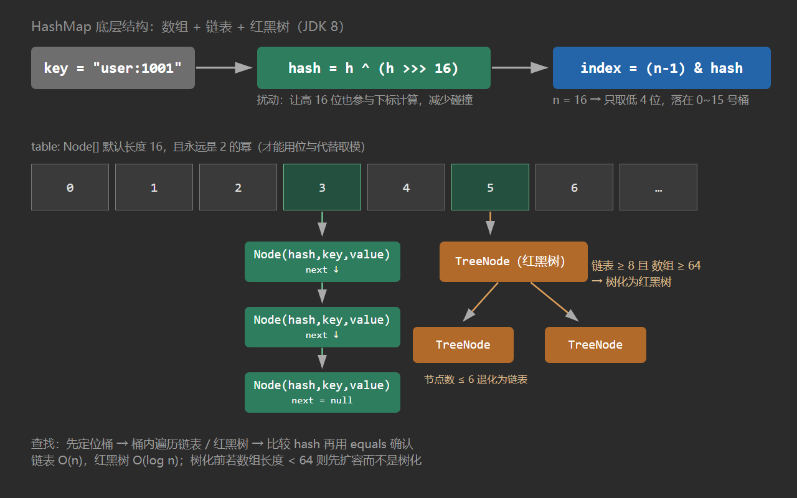

# 6. HashMap 核心原理

**一句话定位**：HashMap 是**数组 + 链表 + 红黑树**的散列表，用扰动后的 hash 定位桶、用 `equals` 消除碰撞、用 0.75 的负载因子在时间和空间之间取平衡。

## 一、数据结构

```
table: Node<K,V>[]            ← 默认 16，长度永远是 2 的幂
┌────┬────┬────┬────┬────┬────┬────┬────┐
│ 0  │ 1  │ 2  │ 3  │ 4  │ 5  │ ...│ 15 │
└─┬──┴────┴─┬──┴────┴────┴────┴────┴────┘
  │         │
  ▼         ▼
 Node ──→ Node ──→ Node            ← 链表（链表长度 ≥ 8 且数组长 ≥ 64 → 转红黑树）
                    │
                    ▼
                TreeNode（红黑树，查找 O(log n)）
```



`Node` 的四个字段：`hash`、`key`、`value`、`next`。`hash` 是**扰动后的结果**，缓存下来避免每次比较都重算。

几个常量（源码里的名字要记住）：

| 常量 | 值 | 含义 |
| --- | --- | --- |
| `DEFAULT_INITIAL_CAPACITY` | 16 | 默认数组长度 |
| `DEFAULT_LOAD_FACTOR` | 0.75 | 负载因子 |
| `TREEIFY_THRESHOLD` | 8 | 链表长度达到 8 时尝试树化 |
| `UNTREEIFY_THRESHOLD` | 6 | 树节点数降到 6 时退化回链表 |
| `MIN_TREEIFY_CAPACITY` | 64 | 树化的最小数组长度，不够就先扩容 |

## 二、hash 函数为什么这么写

```java
static final int hash(Object key) {
    int h;
    return (key == null) ? 0 : (h = key.hashCode()) ^ (h >>> 16);
}
```

定位桶用的是 `(n - 1) & hash`。当 `n = 16` 时只有低 4 位参与运算，高 28 位的信息完全浪费。如果两个 key 的 `hashCode` 只在高位不同、低 4 位相同，就会撞到同一个桶。

`h ^ (h >>> 16)` 把高 16 位异或到低 16 位，让高位也参与桶定位，代价只是一次移位和一次异或。这是“扰动函数”，JDK 8 相比 1.7 的 `h ^= (h >>> 20) ^ (h >>> 12); return h ^ (h >>> 7) ^ (h >>> 4);` 简化了，因为 1.8 引入了红黑树，碰撞的后果没那么严重。

`key == null` 返回 0，所以 **null key 固定落在 0 号桶**，这也是 HashMap 允许一个 null key 的实现方式（Hashtable 不允许，会直接 NPE）。

## 三、put 的完整流程

```java
final V putVal(int hash, K key, V value, boolean onlyIfAbsent, boolean evict) {
    Node<K,V>[] tab; Node<K,V> p; int n, i;
    if ((tab = table) == null || (n = tab.length) == 0)
        n = (tab = resize()).length;              // ① 懒初始化
    if ((p = tab[i = (n - 1) & hash]) == null)
        tab[i] = newNode(hash, key, value, null); // ② 桶空，直接放
    else {
        Node<K,V> e; K k;
        if (p.hash == hash && ((k = p.key) == key || (key != null && key.equals(k))))
            e = p;                                 // ③ 桶首就是同一个 key
        else if (p instanceof TreeNode)
            e = ((TreeNode<K,V>)p).putTreeVal(this, tab, hash, key, value);  // ④ 走红黑树
        else {
            for (int binCount = 0; ; ++binCount) {
                if ((e = p.next) == null) {
                    p.next = newNode(hash, key, value, null);   // ⑤ 尾插
                    if (binCount >= TREEIFY_THRESHOLD - 1)
                        treeifyBin(tab, hash);                  // ⑥ 尝试树化
                    break;
                }
                if (e.hash == hash && ((k = e.key) == key || (key != null && key.equals(k))))
                    break;                                     // ⑦ 链中找到同一个 key
                p = e;
            }
        }
        if (e != null) {                                       // ⑧ 覆盖旧值
            V oldValue = e.value;
            if (!onlyIfAbsent || oldValue == null)
                e.value = value;
            afterNodeAccess(e);
            return oldValue;
        }
    }
    ++modCount;
    if (++size > threshold)
        resize();                                              // ⑨ 超过阈值扩容
    afterNodeInsertion(evict);
    return null;
}
```

几个容易答错的点：

1. **数组是懒初始化的**，第一次 `put` 才分配，`new HashMap<>()` 不会立刻创建 16 长度的数组。
2. **判断 key 相等是“hash 相同 && (`==` 或 `equals`)”**，短路设计：先比 hash，再比地址，最后才 equals。
3. **树化不是链表一到 8 就转**，还要数组长度 ≥ 64，否则先 `resize()`。原因是数组太小时碰撞是“容量不够”造成的，扩容比树化更划算。
4. **退化阈值是 6 不是 8**，中间留了 7 的缓冲带，避免在 8 附近反复树化/退化抖动。

## 四、扩容机制

```java
final Node<K,V>[] resize() {
    // ...
    if (oldCap > 0) {
        if (oldCap >= MAXIMUM_CAPACITY) { threshold = Integer.MAX_VALUE; return oldTab; }
        else if ((newCap = oldCap << 1) < MAXIMUM_CAPACITY && oldCap >= DEFAULT_INITIAL_CAPACITY)
            newThr = oldThr << 1;                 // 阈值也翻倍
    }
    // ... 迁移
    for (int j = 0; j < oldCap; ++j) {
        Node<K,V> e; 
        if ((e = oldTab[j]) != null) {
            oldTab[j] = null;
            if (e.next == null)
                newTab[e.hash & (newCap - 1)] = e;                 // 单节点直接重算位置
            else if (e instanceof TreeNode)
                ((TreeNode<K,V>)e).split(this, newTab, j, oldCap);  // 树拆分
            else {
                Node<K,V> loHead = null, loTail = null;
                Node<K,V> hiHead = null, hiTail = null;
                do {
                    if ((e.hash & oldCap) == 0) {                  // 关键：只看新增的那一位
                        if (loTail == null) loHead = e; else loTail.next = e;
                        loTail = e;
                    } else {
                        if (hiTail == null) hiHead = e; else hiTail.next = e;
                        hiTail = e;
                    }
                } while ((e = e.next) != null);
                if (loTail != null) { loTail.next = null; newTab[j] = loHead; }
                if (hiTail != null) { hiTail.next = null; newTab[j + oldCap] = hiHead; }
            }
        }
    }
}
```

**为什么扩容后不需要重新算 hash**：容量从 16 变成 32，`(n-1)` 从 `1111` 变成 `11111`，多出来的就是第 5 位。所以只要看 `e.hash & oldCap`：

- 为 0 → 新下标还是 `j`
- 非 0 → 新下标是 `j + oldCap`

这就是 1.8 比 1.7 快的原因之一：1.7 每个元素都要重新 `indexFor`，1.8 只做一次位与，并且**保持了链表相对顺序**（lo/hi 两条链分别拼接）。

## 五、为什么容量必须是 2 的幂

1. **位运算替代取模**：`hash & (n - 1)` 等价于 `hash % n`，但只有 n 是 2 的幂时才成立。位运算比除法快一个数量级。
2. **扩容重分布只需要一次位与**：见上一节。
3. **`tableSizeFor` 保证 2 的幂**：`new HashMap<>(17)` 的实际容量是 32：

```java
static final int tableSizeFor(int cap) {
    int n = cap - 1;
    n |= n >>> 1; n |= n >>> 2; n |= n >>> 4; n |= n >>> 8; n |= n >>> 16;
    return (n < 0) ? 1 : (n >= MAXIMUM_CAPACITY) ? MAXIMUM_CAPACITY : n + 1;
}
```

`cap - 1` 是为了处理“本身已经是 2 的幂”的情况，否则 16 会被抬到 32。

## 六、为什么负载因子是 0.75

这是**空间与碰撞概率的折中**：

- 太小（如 0.5）：扩容频繁，空间浪费大；
- 太大（如 1.0）：桶快满了，链表变长，查找退化。

0.75 的另一个依据是源码注释里的泊松分布：在随机 hash 下，一个桶里元素个数服从 λ ≈ 0.5 的泊松分布，8 个元素的概率约为 `0.00000006`。也就是说，正常情况下几乎不可能树化——**树化是防御性设计，用来兜住极端 hash 碰撞（或恶意构造）**，不是常规路径。

## 七、JDK 1.7 的死循环

1.7 用**头插法**迁移链表，并发扩容会成环：

```
线程 A 执行到：Entry<K,V> next = e.next;   // e=A, next=B，然后挂起
线程 B 完成扩容：链表顺序被头插反转成 B → A
线程 A 恢复：继续把 A 头插到新表，再把 B 头插到 A 前面……
结果：A.next = B，B.next = A，形成环
后续 get 落到这个桶 → while (e != null) 无限循环 → CPU 100%
```

1.8 改成**尾插 + lo/hi 拆分**，链表顺序不变，环路问题消失。但 **1.8 的 HashMap 仍然不是线程安全的**：

| 问题 | 后果 |
| --- | --- |
| 并发 put 同一空桶 | 两个线程都判断为空，后写的覆盖先写的，丢数据 |
| 并发 put 触发扩容 | 可能读到迁移中的中间状态，数据丢失 |
| `size++` 非原子 | size 与实际元素数不一致 |
| 并发修改 | 迭代器 fail-fast，抛 `ConcurrentModificationException` |

并发场景直接用 `ConcurrentHashMap`，不要用 `Collections.synchronizedMap`（全表锁，性能差）。

## 八、fail-fast 与 modCount

`modCount` 记录结构修改次数（put、remove、clear；覆盖 value 不算）。迭代器创建时记住 `expectedModCount`，每次 `next()` 检查：

```java
if (modCount != expectedModCount)
    throw new ConcurrentModificationException();
```

这是**尽力而为**的检测，不是并发安全保证：多线程下可能检测不到，单线程下 `for-each` 中 `remove` 一定抛。要删除请用 `Iterator.remove()` 或 `removeIf`。

## 九、面试连环问

**Q：HashMap 的 put 流程？**

懒初始化数组 → `(n-1)&hash` 定位桶 → 空桶直接放 → 非空则比 hash/equals，相同就覆盖 → 不同则链表尾插或红黑树插入 → 链表长度到 8 且数组 ≥64 时树化 → `size > threshold` 时扩容。

**Q：为什么链表转红黑树的阈值是 8，退化是 6？**

8 来自泊松分布（正常情况几乎不可能达到），作为“极端碰撞”的兜底；6 与 8 之间留缓冲，避免在边界反复转换。数组小于 64 时优先扩容而不是树化。

**Q：HashMap 的容量为什么是 2 的幂？**

`hash & (n-1)` 等价取模且更快；扩容时只需判断 `hash & oldCap` 就能决定留在原位还是移动 `oldCap`。构造时传非 2 的幂会被 `tableSizeFor` 向上取整。

**Q：HashMap 允许 null key 吗？**

允许一个，`hash(null)` 返回 0，落在 0 号桶。`Hashtable` 和 `ConcurrentHashMap` 都不允许，会抛 NPE。

**Q：为什么 JDK 8 用尾插？**

::: danger
1.7 头插在并发扩容时会形成环形链表导致死循环；尾插保持顺序、避免成环。注意尾插并没有让 HashMap 变成线程安全。

:::

**Q：HashMap 和 Hashtable 的区别？**

| 维度 | HashMap | Hashtable |
| --- | --- | --- |
| 线程安全 | 否 | 是（方法级 synchronized，全表锁） |
| null | 允许一个 null key、多个 null value | 都不允许 |
| 初始容量 | 16，扩容 ×2 | 11，扩容 ×2+1 |
| 性能 | 高 | 低 |
| 现代替代 | ConcurrentHashMap | ConcurrentHashMap |

**Q：加载因子为什么是 0.75，能改吗？**

可以，构造器可传。调大减少空间浪费但碰撞增多；调小碰撞少但扩容频繁。0.75 是官方基于泊松分布的折中值，非特殊需求不要改。

## 十、自测清单

- [ ] 能默写 `hash()` 的扰动逻辑并解释高 16 位的作用
- [ ] 能说清树化的两个条件（8 和 64）以及退化阈值 6
- [ ] 能解释扩容时 `e.hash & oldCap` 的两种结果
- [ ] 能证明容量必须是 2 的幂
- [ ] 能说出负载因子 0.75 与泊松分布的关系
- [ ] 能复述 1.7 头插死循环的步骤
- [ ] 知道 1.8 仍线程不安全，以及四种具体表现
- [ ] 能区分 fail-fast 与并发安全

## 延伸阅读

- [HashMap 源码（JDK 17）](https://github.com/openjdk/jdk/blob/master/src/java.base/share/classes/java/util/HashMap.java)
- [7. ConcurrentHashMap](/guide/t07)
- [2. == 与 equals()、hashCode()](/guide/t02)
