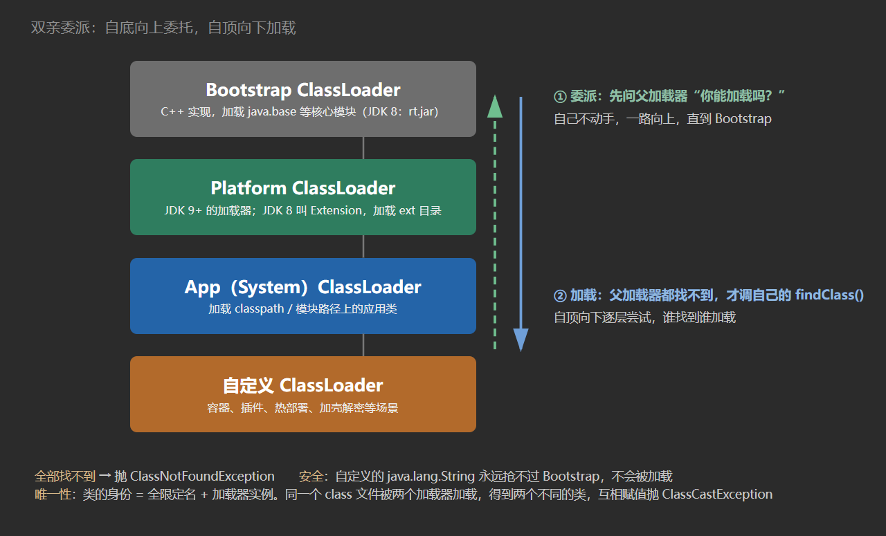

# 17. 类加载机制

**一句话定位**：类的生命周期是**加载 → 验证 → 准备 → 解析 → 初始化 → 使用 → 卸载**，其中“加载、验证、准备、初始化、卸载”有严格顺序；双亲委派保证核心类不被篡改，SPI 和 Tomcat 则主动打破它。

## 一、七个阶段

```
加载 → 验证 → 准备 → 解析 → 初始化 → 使用 → 卸载
       └────── 连接（Linking）──────┘
```

| 阶段 | 做什么 |
| --- | --- |
| 加载 | 通过全限定名获取二进制字节流 → 转成方法区（元空间）的运行时数据结构 → 在堆中生成 `Class` 对象作为访问入口 |
| 验证 | 文件格式、元数据、字节码、符号引用验证，防止恶意字节码 |
| 准备 | 为**静态变量**分配内存并赋**零值**（`int=0`、引用 `null`），`static final` 常量在准备阶段就赋初值 |
| 解析 | 符号引用 → 直接引用（内存地址/偏移量） |
| 初始化 | 执行 `<clinit>()`：静态变量赋值 + 静态代码块，按源码顺序合并 |
| 使用 | 正常 new、调用方法 |
| 卸载 | 类加载器可回收、无实例、无 Class 引用时才卸载 |

两个易错点：

1. **准备阶段赋零值，初始化阶段才赋真实值**：

```java
public static int value = 123;              // 准备阶段 value = 0，初始化阶段才变 123
public static final int CONST = 123;        // 准备阶段直接是 123（常量）
```

2. **`<clinit>()` 是线程安全的**。JVM 保证同一个类的初始化只执行一次，其他线程阻塞等待。静态内部类单例就是利用这一点实现的。

## 二、类加载器

### JDK 8 及之前

```
Bootstrap ClassLoader     加载 <JAVA_HOME>/lib 下的核心类（rt.jar 等），C++ 实现
      ↑
Extension ClassLoader     加载 <JAVA_HOME>/lib/ext 下的扩展类
      ↑
Application ClassLoader   加载 classpath 上的应用类
      ↑
自定义 ClassLoader
```

### JDK 9 及之后

JDK 9 引入模块化，**Extension ClassLoader 被删除**，换成 Platform ClassLoader：

| 加载器 | 加载内容 |
| --- | --- |
| Bootstrap | `java.base` 等核心模块，由 JVM 实现，`getSystemClassLoader().getParent()` 拿不到（返回 null） |
| Platform | 原 Extension 的职责 + 部分 JDK 模块 |
| App（System） | classpath / 模块路径上的应用类 |
| 自定义 | 容器、插件、热部署等 |

::: info
还在背“ExtClassLoader 加载 ext 目录”的要注意版本：这是 JDK 8 的知识。

:::

## 三、双亲委派

```java
protected Class<?> loadClass(String name, boolean resolve) throws ClassNotFoundException {
    synchronized (getClassLoadingLock(name)) {
        Class<?> c = findLoadedClass(name);          // ① 已加载过就直接返回
        if (c == null) {
            try {
                if (parent != null) {
                    c = parent.loadClass(name, false);   // ② 先委托父加载器
                } else {
                    c = findBootstrapClassOrNull(name);  // ③ 到顶了，交给 Bootstrap
                }
            } catch (ClassNotFoundException ignored) { }
            if (c == null) {
                c = findClass(name);                     // ④ 父加载器都找不到，才自己加载
            }
        }
        if (resolve) resolveClass(c);
        return c;
    }
}
```

顺序记成一句话：**自底向上委托，自顶向下加载**。



两个作用：

- **安全**：自定义 `java.lang.String` 永远不会被加载，因为 Bootstrap 会先加载 JDK 的版本，`findLoadedClass` 直接命中。
- **唯一性**：同一个类由同一个加载器加载，全限定名 + 加载器实例共同确定一个类。同一个 class 文件被两个加载器加载，得到的是两个不同的类，互相赋值会抛 `ClassCastException`。

## 四、什么情况会初始化

主动引用（触发初始化）：

1. `new`、读写静态字段（非 final）、调用静态方法；
2. 反射 `Class.forName("...")`（默认 initialize=true）；
3. 初始化子类时先初始化父类；
4. 虚拟机启动时的主类（含 `main`）；
5. `MethodHandle` / `VarHandle` 解析到的类。

被动引用（不触发初始化）：

| 场景 | 为什么 |
| --- | --- |
| 通过子类访问父类静态字段 | 只有真正定义该字段的类会被初始化 |
| `new Type[]` 数组 | 数组类型由 JVM 自动生成，不初始化元素类 |
| 引用 `static final` 常量 | 编译期已把常量折叠进调用方常量池 |

## 五、打破双亲委派

| 场景 | 为什么打破 | 怎么做 |
| --- | --- | --- |
| JDBC SPI | `DriverManager` 在 Bootstrap 中，看不到 classpath 上的驱动实现 | `Thread.currentThread().getContextClassLoader()` 拿到线程上下文类加载器（默认 App），反向加载 |
| Tomcat | 每个 WebApp 需要独立加载 `WEB-INF/lib`，实现应用隔离、多版本共存 | 每个应用一个 `WebappClassLoader`，重写 `loadClass`：先自己找，找不到再委托父加载器 |
| OSGi | 模块化热部署，模块间按需导入导出 | 网状委派，按 package 而非 class 委派 |
| 热部署/插件 | 同一个类需要重新加载 | 每次新建一个 ClassLoader 加载新版本，旧加载器连同旧类一起被回收 |

Tomcat 的类加载顺序：

```
Bootstrap → Platform → App → WebappClassLoader（先本地 WEB-INF/classes、WEB-INF/lib）
```

注意 Tomcat 并没有完全抛弃委派，而是对“自己应用内的类”优先自加载，对 JDK 核心类仍然先委派——否则 `java.lang.String` 又会被覆盖。

## 六、类卸载的条件

一个类要被卸载，必须同时满足：

1. 该类的所有实例都被回收；
2. 加载该类的 `ClassLoader` 已被回收；
3. 该类的 `Class` 对象没有被任何地方引用（包括反射、JNI、静态字段）。

实际应用中，**应用类加载器几乎不会被回收**，所以业务类基本不卸载。能卸载的典型是 OSGi、热部署、动态代理生成的一次性类——这也是元空间泄漏的排查重点。

## 七、面试连环问

**Q：类的生命周期？**

加载、验证、准备、解析、初始化、使用、卸载。验证/准备/解析合称连接。解析阶段可以在初始化之后（为了支持动态绑定）。

**Q：准备阶段和初始化阶段的区别？**

准备阶段给静态变量分配内存并赋零值（`final` 常量直接赋初值）；初始化阶段执行 `<clinit>()`，给静态变量赋真实值、执行静态代码块。

**Q：双亲委派是什么？为什么需要？**

加载类时先委托父加载器，父加载器加载不了才自己加载。保证核心类库不被篡改，保证同一个类只被加载一次。

**Q：怎么打破双亲委派？**

重写 `loadClass()`（不调用 `super.loadClass`，或调整委托顺序），或者用线程上下文类加载器反向委托。典型场景：JDBC SPI、Tomcat 应用隔离、OSGi。

**Q：JDK 9 的类加载器有什么变化？**

Extension ClassLoader 被移除，换成 Platform ClassLoader；Bootstrap 仍由 JVM 实现；模块化后核心类按模块加载。`ClassLoader.getSystemClassLoader()` 仍是 AppClassLoader。

**Q：两个不同加载器加载同一个 class 文件，是同一个类吗？**

不是。类的唯一性由“全限定名 + 定义类加载器”共同决定。把 A 加载的实例赋给 B 加载的类，会抛 `ClassCastException`，报错信息里能看到两个加载器名字。

**Q：`Class.forName` 和 `ClassLoader.loadClass` 的区别？**

`Class.forName` 默认会初始化类（执行静态块），`loadClass` 只加载不初始化。JDBC 老代码 `Class.forName("com.mysql.jdbc.Driver")` 就是用初始化来触发驱动的静态注册。

## 八、自测清单

- [ ] 能按顺序默写七个阶段，并说明哪些阶段顺序固定
- [ ] 能区分准备阶段的零值和初始化阶段的赋值
- [ ] 能说出 JDK 8 与 JDK 9+ 类加载器层级的差异
- [ ] 能默写 `loadClass` 的四步并解释“自底向上委托”
- [ ] 能列出五种主动引用和三种被动引用
- [ ] 能说出 JDBC SPI 打破双亲委派的完整链路
- [ ] 能解释 Tomcat 的类加载顺序为什么仍保留委派
- [ ] 能说出类卸载的三个条件

## 延伸阅读

- [JVM 规范：Loading, Linking, and Initializing](https://docs.oracle.com/javase/specs/jvms/se17/html/jvms-5.html)
- [JEP 261: Module System](https://openjdk.org/jeps/261)
- [15. 运行时数据区](/guide/t15)
- [4. 反射与动态代理](/guide/t04)
