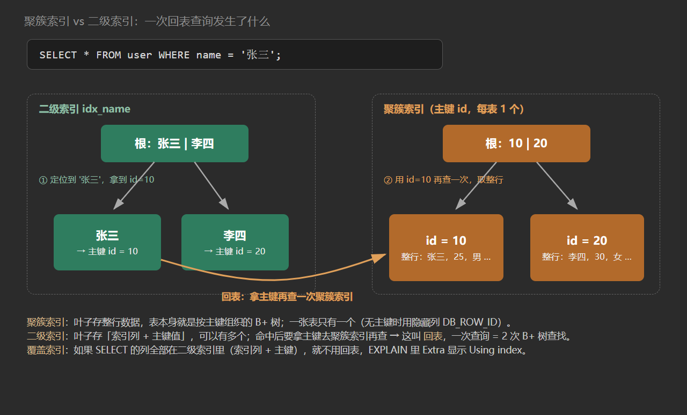

# 19. 索引

**一句话定位**：InnoDB 的索引是 **B+ 树**——用“矮胖”的多叉树把磁盘 IO 压到 3~4 次，用叶子链表把范围查询变成顺序遍历。

## 一、为什么是 B+ 树

| 结构 | 单次查找 | 范围查询 | 磁盘友好度 |
| --- | --- | --- | --- |
| 二叉搜索树 / 红黑树 | 树高 log₂N，节点多 | 中序遍历，跳来跳去 | 差（树高，IO 多） |
| 哈希表 | O(1) 等值 | ❌ 不支持范围 | 差（无序） |
| B 树 | 树高 logₘN | 中序遍历，跨层 IO | 中（节点存数据，分叉少） |
| B+ 树 | 树高 logₘN | 叶子链表顺序扫描 | 好（非叶子只存 key，分叉多） |

B+ 树的两个关键设计：

1. **非叶子节点只存 key，不存数据**。一个 16KB 的页能放更多索引项，分叉更宽、树更矮。三层 B+ 树大概能索引两千万行，一次主键查询 3~4 次 IO。
2. **所有数据都在叶子节点，叶子之间用双向链表连接**。范围查询定位到起点后顺着链表走，不用回到上层。

```
                 [ 10 | 20 | 30 ]            ← 非叶子：只存 key，纯导航
              /        |        \
      [1|5|8]      [12|15|18]     [22|28|35]   ← 叶子：存 key + 数据（或主键）
        ↕             ↕              ↕
     双向链表 ─────────────────────────→ 范围扫描
```

### 为什么不用哈希索引

哈希索引等值查询 O(1)，但不支持范围、排序、最左前缀，且哈希冲突要遍历链表。InnoDB 只有**自适应哈希索引**（AHI）作为内部优化，不能手动创建。

## 二、聚簇索引与二级索引

| 类型 | 叶子节点存什么 | 数量 | 说明 |
| --- | --- | --- | --- |
| 聚簇索引（主键索引） | **整行数据** | 1 个 | 表数据本身就是按主键组织的 B+ 树 |
| 二级索引（辅助索引） | 索引列 + **主键值** | 多个 | 查到主键后还要回表 |

**回表**：通过二级索引找到主键，再拿主键去聚簇索引查整行。一次二级索引查询 = 2 次 B+ 树查找。

```sql
SELECT * FROM user WHERE name = '张三';
-- ① 在 idx_name 上找到 '张三' 对应的主键 id=42
-- ② 用 id=42 回表，在聚簇索引上取整行
```



如果二级索引里已经包含查询需要的所有列，就不用回表，这就是**覆盖索引**（见 [22. 覆盖索引、索引下推](/guide/t22)）。

### 没有主键怎么办

InnoDB 的选择顺序：

1. 显式主键；
2. 第一个不含 NULL 的唯一索引；
3. 都没有 → 自动生成 6 字节的隐藏列 `DB_ROW_ID` 作为聚簇索引。

所以“每张表都该有主键”不只是规范问题——没有主键时，二级索引存的是隐藏 row_id，你也没法用它做业务查询。

## 三、自增主键 vs UUID

| 维度 | 自增 BIGINT | UUID（36 字符）/ 随机字符串 |
| --- | --- | --- |
| 插入位置 | 总在 B+ 树最右侧追加 | 随机落在中间 |
| 页分裂 | 少（顺序写） | 频繁（要挪动数据、拆页） |
| 空间 | 8 字节 | 36 字节（char(36)），二级索引全部变大 |
| 缓存命中 | 高（热点页集中在右侧） | 低 |
| 分布式唯一 | 需要发号器/雪花算法 | 天然唯一 |

自增主键的核心优势是**顺序插入**：B+ 树只在最右侧追加，页利用率高，不会频繁分裂。UUID 随机插入会导致页分裂、碎片、二级索引膨胀（每个二级索引都要存主键）。

分布式场景用**雪花算法**（趋势递增的 64 位 ID）兼顾唯一性和顺序性。

## 四、联合索引与最左前缀

```sql
ALTER TABLE t ADD INDEX idx_abc (a, b, c);
```

索引按 `(a, b, c)` 的顺序排序，等价于先按 a 排、a 相同按 b 排、b 相同按 c 排。

| 查询条件 | 能否用索引 | 用到哪些列 |
| --- | --- | --- |
| `a = 1` | ✅ | a |
| `a = 1 AND b = 2` | ✅ | a、b |
| `a = 1 AND b = 2 AND c = 3` | ✅ | a、b、c |
| `b = 2` | ❌ | 无法定位（a 无序） |
| `a = 1 AND c = 3` | ⚠️ | 只用 a，c 退化为过滤 |
| `a > 1 AND b = 2` | ⚠️ | 用 a 做范围，b 无法继续定位 |

**范围查询会截断后续列**：`a > 1` 之后，b 在索引里不是全局有序的，只能靠索引下推在索引层过滤，不能用于定位。

建联合索引的口诀：**等值在前，范围在后；区分度高的在前**。

## 五、索引失效的常见场景

| 场景 | 原因 | 改法 |
| --- | --- | --- |
| `WHERE name LIKE '%张'` | 左模糊无法定位起点 | 改成 `'张%'`，或用全文索引/倒排 |
| `WHERE id + 1 = 10` | 列上做运算 | 改成 `id = 9` |
| `WHERE DATE(create_time) = '2024-01-01'` | 函数作用在列上 | 改成范围 `>= '2024-01-01' AND < '2024-01-02'` |
| `WHERE phone = 13800000000`（phone 是 varchar） | 隐式类型转换，等价于 `CAST(phone AS int)` | 加引号：`phone = '13800000000'` |
| `WHERE a = 1 OR b = 2`（b 无索引） | OR 要求两边都能走索引 | 给 b 加索引，或拆成 UNION |
| `WHERE name IS NOT NULL` 且选择性差 | 优化器判断全表扫描更快 | 不一定失效，看执行计划 |
| 联合索引跳过最左列 | 无法定位 | 调整索引顺序或补索引 |

::: warning
**“索引失效”很多时候不是真的失效，而是优化器算完成本觉得全表扫描更便宜**。判断依据永远是 `EXPLAIN` 的 `type`、`key`、`rows`，不是口诀。

:::

## 六、索引的选择性与维护成本

**选择性 = 不重复值数量 / 总行数**，越接近 1 越好。性别列选择性约 0.5，单独建索引意义不大；手机号、订单号接近 1，适合建索引。

索引不是越多越好：

| 成本 | 说明 |
| --- | --- |
| 写放大 | 每次 INSERT/UPDATE/DELETE 都要维护所有相关索引 |
| 空间 | 二级索引存索引列 + 主键 |
| 优化器负担 | 索引太多，执行计划选择可能出错 |
| 页分裂 | 随机索引列导致插入时分裂 |

经验值：单表索引控制在 5 个以内，联合索引优先于多个单列索引。

## 七、EXPLAIN 要看哪几列

| 列 | 关注点 |
| --- | --- |
| `type` | 访问类型，从好到差：`system > const > eq_ref > ref > range > index > ALL`，至少要到 `range` |
| `key` | 实际使用的索引，为 NULL 说明没走索引 |
| `key_len` | 用到的索引字节数，可判断联合索引用了几列 |
| `rows` | 预估扫描行数，越小越好 |
| `filtered` | 过滤后剩余行的百分比 |
| `Extra` | `Using index`（覆盖索引）、`Using index condition`（ICP）、`Using filesort`、`Using temporary` 要重点看 |

## 八、面试连环问

**Q：为什么用 B+ 树而不是 B 树？**

B 树非叶子节点也存数据，同样大小的页能放的 key 更少，树更高、IO 更多；B+ 树非叶子只存 key，分叉多、树矮，且叶子有链表，范围查询更高效。

**Q：为什么不用红黑树？**

红黑树是二叉的，树高约 2log₂N，千万级数据树高 40+，每次节点访问都是一次磁盘 IO，根本不可接受。B+ 树一个节点就是一个 16KB 页，一次 IO 能比较上百个 key。

**Q：聚簇索引和二级索引的区别？**

聚簇索引叶子存整行，一张表只有一个；二级索引叶子存索引列 + 主键，查到后需要回表。覆盖索引可以避免回表。

**Q：为什么推荐自增主键？**

顺序插入只在 B+ 树右侧追加，页分裂少、碎片少；UUID 随机插入导致页分裂和索引膨胀。

**Q：联合索引 (a,b,c)，where b=1 and c=2 能走索引吗？**

不能定位。最左列 a 没有等值条件，b、c 在索引里不是全局有序的。除非用覆盖索引做全索引扫描（`type=index`），那也比全表扫描好一点，但不是“用上了索引定位”。

**Q：索引一定会加快查询吗？**

不一定。区分度低、返回行数占比高（一般超过 20%~30%）时，全表扫描可能更快，优化器会放弃索引。索引还有写放大和空间成本。

**Q：`WHERE name LIKE '%张%'` 能优化吗？**

前缀模糊无法用 B+ 树定位。可选方案：全文索引（`FULLTEXT`）、倒排索引（ES）、把模糊查询改成前缀匹配、或者用覆盖索引做索引扫描减少回表。

## 九、自测清单

- [ ] 能画出 B+ 树结构并解释为什么树矮
- [ ] 能说出聚簇索引与二级索引叶子节点各存什么
- [ ] 能解释回表，并说出避免回表的方法
- [ ] 能比较自增主键与 UUID 的四个差异
- [ ] 能根据 `(a,b,c)` 判断各种 WHERE 组合能用几列
- [ ] 能列出至少六种索引失效场景及改法
- [ ] 知道“失效”很多时候是优化器的成本选择
- [ ] 能说出 `EXPLAIN` 里 `type`、`key_len`、`Extra` 的作用
- [ ] 能解释索引的选择性与维护成本

## 延伸阅读

- [MySQL 8.0 参考手册：Optimization and Indexes](https://dev.mysql.com/doc/refman/8.0/en/optimization-indexes.html)
- [22. 覆盖索引、索引下推](/guide/t22)
- [21. 事务与 MVCC](/guide/t21)
