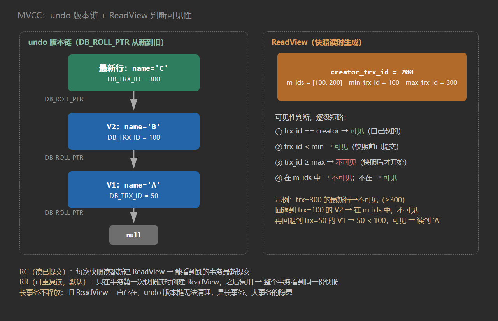

# 21. 事务与 MVCC

## 一、事务的三大问题

**Q：脏读、不可重复读、幻读分别是什么？**

| 问题 | 现象 |
| --- | --- |
| 脏读 | 读到了其他事务**未提交**的数据 |
| 不可重复读 | 同一事务中两次读**同一行**，内容不同（中间别的事务修改并提交了） |
| 幻读 | 同一事务中两次按**同一条件**查询，行数不同（中间别的事务插入或删除了符合条件的行） |

- **脏读**：读到别的事务还没提交的数据。如果那个事务回滚了，你读到的就是从来没真实存在过的值。
- **不可重复读**：重点在"同一行的内容变了"。
- **幻读**：重点在"多出来或消失的行"，像出现了幻觉。

一句话区分：不可重复读针对某一行内容的变化，幻读针对整个条件范围内行数的变化。

**Q：MySQL 四种隔离级别？默认是什么？**

| 级别 | 脏读 | 不可重复读 | 幻读 |
| --- | --- | --- | --- |
| Read Uncommitted | ✅ 可能 | ✅ | ✅ |
| Read Committed（RC） | ❌ | ✅ | ✅ |
| Repeatable Read（RR）— 默认 | ❌ | ❌ | 快照读已解决，当前读靠 Next-Key Lock 抑制 |
| Serializable | ❌ | ❌ | ❌ |

- **Read Uncommitted**：允许读未提交数据，三种问题全都有。
- **Read Committed**：挡掉脏读。每条 SELECT 都生成新的 ReadView，所以两次读同一行可能不一样。
- **Repeatable Read**：MySQL 默认级别。只在事务第一次 SELECT 时生成 ReadView 并复用，脏读、不可重复读都挡掉。幻读要分两种读看：快照读走同一份视图，不会新增行；当前读（`SELECT ... FOR UPDATE`、`UPDATE`、`DELETE`）靠 Next-Key Lock 抑制插入。
- **Serializable**：读也加锁，读写互斥，三种问题都没有，代价是并发极差，实际几乎不用。

## 二、MVCC

**Q：MVCC 是什么？解决什么问题？**

MVCC（Multi-Version Concurrency Control，多版本并发控制）是 InnoDB 引擎层的机制：**让读和写作用于数据的不同版本，从而实现读写不阻塞**。

没有 MVCC 的话，读要加锁、写也要加锁，读阻塞写、写阻塞读，并发能力很差。MVCC 的核心取舍是：读不加锁，改成读一个"快照"，写正常改最新数据，两者互不干扰。

实现它只需要三件套：**隐藏字段、undo 版本链、ReadView**。

### 2.1 隐藏字段

InnoDB 的每行记录除了用户定义的列，还有几个隐藏列：

| 隐藏字段 | 大小 | 含义 |
| --- | --- | --- |
| `DB_TRX_ID` | 6 字节 | 最后插入或修改这行数据的事务 ID |
| `DB_ROLL_PTR` | 7 字节 | 回滚指针，指向 undo log 中的上一个版本 |
| `DB_ROW_ID` | 6 字节 | 行 ID。只有表既没有主键、也没有非空唯一索引时才会生成 |

`DB_ROLL_PTR` 不是内存地址，而是一个逻辑地址，按"回滚段号 + undo 页号 + 页内偏移"定位到 undo 记录。详细拆解见 [20. 三大日志](/guide/t20)。

### 2.2 undo 版本链

每次 UPDATE / DELETE 都会把旧版本写进 undo log，新版本留在数据页里，通过 `DB_ROLL_PTR` 串起来：

```
最新行（Buffer Pool 中的数据页）
  name='C', DB_TRX_ID=300
        │ DB_ROLL_PTR
        ▼
  undo 版本 V2：name='B', DB_TRX_ID=100
        │ DB_ROLL_PTR
        ▼
  undo 版本 V1：name='A', DB_TRX_ID=50
        │ DB_ROLL_PTR
        ▼
      null（链尾）
```

快照读时如果最新版本“不可见”，就顺着链往回找，直到找到一个可见版本。



### 2.3 ReadView

ReadView 是事务做快照读时生成的一份"可见性名单"，包含四个字段：

| 字段 | 含义 |
| --- | --- |
| `m_ids` | 生成 ReadView 时，所有**活跃（未提交）**事务的 ID 列表 |
| `min_trx_id` | `m_ids` 中的最小值 |
| `max_trx_id` | 下一个将要分配的事务 ID（即生成时已分配的最大 ID + 1） |
| `creator_trx_id` | 当前事务自己的 ID |

**🔥 Q：可见性判断规则是什么？**

判断顺序是逐级短路，一旦命中立即返回：

```
① DB_TRX_ID == creator_trx_id ？
   → 是：✅ 可见（自己改的，自己当然能看到）
   → 否：继续

② DB_TRX_ID < min_trx_id ？
   → 是：✅ 可见（生成 ReadView 之前就已经提交）
   → 否：继续

③ DB_TRX_ID >= max_trx_id ？
   → 是：❌ 不可见（生成 ReadView 之后才开始的事务）
   → 否：继续

④ min_trx_id <= DB_TRX_ID < max_trx_id：
   → 在 m_ids 中：❌ 不可见（生成时还活跃，可能未提交）
   → 不在 m_ids 中：✅ 可见（虽然 ID 在区间内，但当时已经提交）
```

用伪代码写出来就这四行：

```java
boolean visible(long trxId, ReadView view) {
    if (trxId == view.creatorTrxId) return true;      // 自己改的
    if (trxId < view.minTrxId)     return true;       // 快照前已提交
    if (trxId >= view.maxTrxId)    return false;      // 快照后才开始
    return !view.activeIds.contains(trxId);           // 快照时活跃 → 不可见
}
```

当前版本不可见，就顺着 `DB_ROLL_PTR` 找上一个版本，重复上面的判断。

**🔥 Q：能推演一个具体的读取过程吗？**

设定：初始行 `id=1, name='A'`，`DB_TRX_ID=50` 且已提交；事务 100、200、300、400 依次启动。

**场景一：事务 200 做快照读**

事务 100 已经把 `name` 改成 `'B'` 但还没提交，此时：

```
RV200：m_ids=[100,200]，min_trx_id=100，max_trx_id=300，creator_trx_id=200
```

判断最新行（`name='B'`, `DB_TRX_ID=100`）：

1. `100 == 200`？否
2. `100 < 100`？否
3. `100 >= 300`？否
4. `100` 在 `m_ids` 中？是 → ❌ 不可见

回退到 undo 版本（`name='A'`, `DB_TRX_ID=50`）：

1. `50 == 200`？否
2. `50 < 100`？是 → ✅ 可见

结果：读到 `'A'`。那次修改还没提交，读到的只能是旧值。

**场景二：事务 400 先写后读**

1. 执行 `UPDATE ... SET name='D'`：当前读，读最新版本、把旧版本写进 undo、修改内存行，**不创建 ReadView**；
2. 执行 `SELECT`：第一次快照读，创建 `RV400`，`creator_trx_id=400`；
3. 判断最新行（`name='D'`, `DB_TRX_ID=400`）：`400 == 400`？是 → ✅ 可见。

结果：读到 `'D'`，自己改的当然能看到。

### 2.4 RC 与 RR

**🔥 Q：RC 和 RR 的区别到底在哪？**

差别只有一处：**ReadView 生成几次**。

| 隔离级别 | ReadView 生成时机 | 行为 |
| --- | --- | --- |
| RC | 每次 SELECT 都重新生成 | 能读到别的事务最新提交的数据 → 不可重复读 |
| RR | 事务第一次 SELECT 时生成，之后复用 | 始终看同一份快照 → 可重复读 |

**RC 的例子：**

```
事务 A：SELECT * FROM t WHERE id=1 → age=20    （生成 ReadView #1）
事务 B：UPDATE t SET age=21 WHERE id=1 → COMMIT
事务 A：SELECT * FROM t WHERE id=1 → age=21    （生成 ReadView #2，看到提交）
                                                  → 不可重复读 ✅
```

**RR 的例子：**

```
事务 A：SELECT * FROM t WHERE id=1 → age=20    （生成 ReadView，B 记在 m_ids 里）
事务 B：UPDATE t SET age=21 WHERE id=1 → COMMIT
事务 A：SELECT * FROM t WHERE id=1 → age=20    （复用同一个 ReadView，B 仍被视为活跃）
                                                  → 可重复读 ✅
```

所以"RR 可重复读"不是把数据冻住了，而是**一直用同一份可见性名单去版本链里挑版本**。

### 2.5 快照读与当前读

**🔥 Q：什么是快照读？什么是当前读？为什么 UPDATE 不走 MVCC？**

| 类型 | 典型语句 | 走 MVCC | 读什么 | 是否加锁 |
| --- | --- | --- | --- | --- |
| 快照读 | 普通 `SELECT` | ✅ | 版本链中对自己可见的版本 | ❌ 不加锁 |
| 当前读 | `SELECT ... FOR UPDATE` | ❌ | 数据页中的最新已提交版本 | ✅ 加 X 锁 + 间隙锁 |
| 当前读 | `SELECT ... LOCK IN SHARE MODE` | ❌ | 最新已提交版本 | ✅ 加 S 锁 |
| 当前读 | `UPDATE` / `DELETE` / `INSERT` | ❌ | 最新版本 | ✅ 加锁 |

UPDATE 必须先读最新版本，因为它是"读-改-写"：如果基于旧版本算，就会把别的事务已经提交的修改直接覆盖掉，产生**丢失更新**。所以写操作一律走当前读。

**🔥 Q：RR 下同一个事务两次快照读，ReadView 相同吗？中间有当前读呢？**

核心：**当前读和快照读是两条独立的读取路径，互不影响**。

1. **两次都是快照读**：ReadView 相同，结果完全一致，这就是可重复读。
2. **中间有当前读**（`FOR UPDATE` / `UPDATE` / `DELETE`）：
   - 当前读读最新版本并加锁，不走 undo 版本链；
   - 后续的快照读**仍然用最初那个 ReadView**，不会看到别的事务新提交的数据。

```
快照读：undo 版本链 + ReadView 可见性判断  → 一致性快照
当前读：最新记录 + 锁                        → 最新已提交
```

示例：

```
事务 A（RR）：
1. SELECT * FROM t WHERE id=1 → age=20        ← 生成 ReadView
2. SELECT * FROM t WHERE id=1 FOR UPDATE → age=21
                                              ← 当前读，读到 B 已提交的新值
3. SELECT * FROM t WHERE id=1 → age=20        ← 快照读，仍是第 1 步的 ReadView
```

这就是 InnoDB 的设计取舍：快照读不阻塞当前读，当前读不阻塞快照读，读多写少的场景吞吐很高。

### 2.6 幻读

**🔥 Q：RR 下幻读到底解决了没有？**

要分两种读看：

| 读类型 | 幻读情况 | 原因 |
| --- | --- | --- |
| 快照读 | 不会幻读 | 全程复用同一份 ReadView，新插入的行对这份快照不可见 |
| 当前读 | 基本抑制 | Next-Key Lock = 记录锁 + 间隙锁，锁住索引记录之间的间隙，别的事务插不进来 |

但要注意，RR 并不是在所有场景下 100% 消除幻读。一个经典反例：

```
事务 A：BEGIN
事务 A：SELECT * FROM t WHERE id > 100;      ← 快照读，看到 1 行
事务 B：INSERT INTO t VALUES (200); COMMIT   ← 插入并提交
事务 A：UPDATE t SET c=1 WHERE id > 100;     ← 当前读，影响 2 行（包括新插入的）
事务 A：SELECT * FROM t WHERE id > 100;      ← 快照读，仍然只看到 1 行
```

事务 A 的 UPDATE 明明改到了"看不见"的那一行，但快照读又看不到它——这被称为 RR 下的幻读现象。所以严谨的说法是：**InnoDB 在 RR 下用 MVCC 解决了快照读的幻读，用 Next-Key Lock 抑制当前读的幻读，但不是绝对消除**。

### 2.7 长事务

**Q：为什么说长事务是 MVCC 最大的隐患？**

MVCC 靠 undo 版本链活着，而 undo 能不能清理取决于最老的 ReadView。长事务让一个 ReadView 长期存活，Purge 就不敢清理它之后的任何 undo：

```
长事务一直不提交
  → 全局最老的 min_trx_id 一直很小
  → 之后的 undo 版本都无法清理
  → History List 膨胀 → undo 表空间膨胀 → 磁盘可能写满
  → 版本链变长 → 快照读回溯变慢 → 查询越来越慢
```

这个过程的详细机制和监控 SQL 见 [20. 三大日志](/guide/t20) 的 Purge 部分。

## 三、面试回答模板

**MVCC：**

::: tip
> MVCC 依赖三件套：隐藏字段、undo 版本链、ReadView。`DB_TRX_ID` 记录最后修改这行的事务，`DB_ROLL_PTR` 指向 undo 里的上一个版本。快照读时创建 ReadView，可见性判断分四步：先看是不是自己改的，再看是否小于最小活跃 ID，再看是否大于等于最大 ID，最后查活跃列表；不可见就顺着版本链回退。
>
> RC 每次 SELECT 新建 ReadView，RR 只在第一次 SELECT 创建并复用。UPDATE、DELETE、FOR UPDATE 是当前读，不走 MVCC，因为它们必须基于最新数据修改，否则会丢失更新。
>
> 长事务会阻止 Purge 清理 undo，导致版本链膨胀，这是 MVCC 最大的隐患。

:::

## 四、自测清单

- [ ] 能区分脏读、不可重复读、幻读
- [ ] 能说出四种隔离级别和 MySQL 默认级别
- [ ] 能说出 MVCC 三件套分别是什么
- [ ] 知道 `DB_TRX_ID`、`DB_ROLL_PTR`、`DB_ROW_ID` 的大小和作用
- [ ] 能画出 undo 版本链
- [ ] 能默写可见性判断的四个步骤
- [ ] 能推演给定事务 ID 下的读取结果
- [ ] 能说清 RC 和 RR 的 ReadView 生成时机差异
- [ ] 能区分快照读和当前读
- [ ] 能解释 UPDATE 为什么必须走当前读
- [ ] 能说清 RR 下幻读在快照读和当前读中的不同表现
- [ ] 能解释长事务为什么会撑爆 undo

## 延伸阅读

- [20. 三大日志](/guide/t20)
- [19. 索引](/guide/t19)
- [MySQL 8.0 Reference Manual: InnoDB Multi-Versioning](https://dev.mysql.com/doc/refman/8.0/en/innodb-multi-versioning.html)
- [MySQL 8.0 Reference Manual: Consistent Nonlocking Reads](https://dev.mysql.com/doc/refman/8.0/en/innodb-consistent-read.html)
